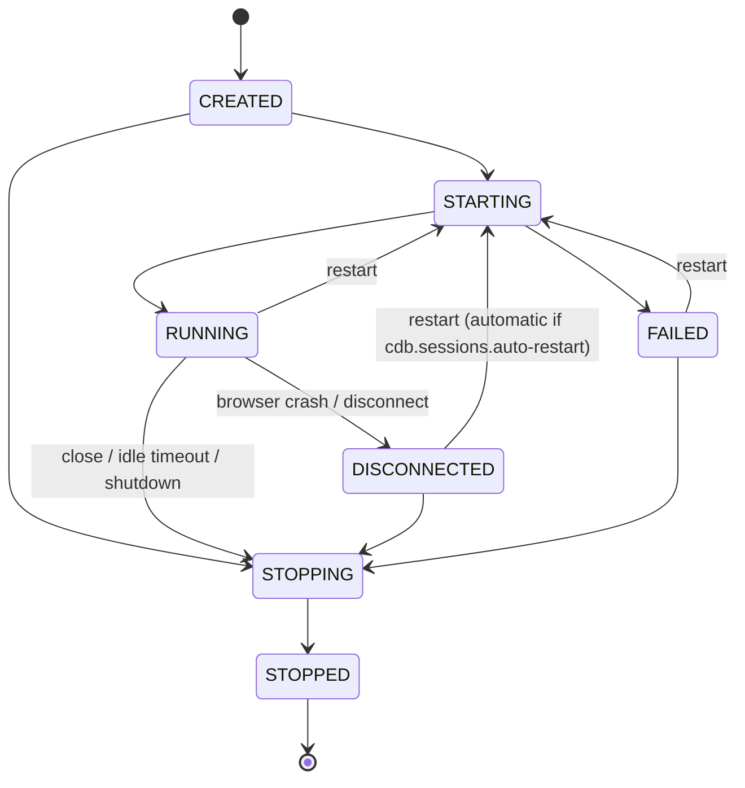

# Session Lifecycle

* Transitions are enforced by `SessionState.canTransitionTo`; each one publishes `browser.session.state`.
* `CREATED → STARTING → RUNNING` happens inside `POST /sessions`. A failed start leaves the session `FAILED`, visible
  with its `failureReason` and restartable.
* Disconnect detection: `Browser.onDisconnected` (provider) and a periodic `isConnected()` check (`maintain()` every 15 s).
* Restart recreates the browser context (relaunching the browser if needed) and reopens the previous URLs that are
  still allowed by the URL policy.
* Idle expiry: sessions untouched for `idleTimeout` (default 30 min, per session via `idleTimeoutSeconds`) are closed.
* Closing releases the context, tabs and (for `PROCESS` isolation) the browser process and worker thread, removes the
  session, and publishes `browser.session.closed`.
* On driver shutdown all sessions are closed, then the provider and Playwright are closed.

## Session record

| Field | Meaning |
|---|---|
| `sessionId` | `session-xxxxxxxx` |
| `projectId` | Free-form project identifier (the IDE uses the project name) |
| `contextId` | Browser context id |
| `activeTabId` | Active tab (`tab-N`) |
| `currentUrl`, `title` | Last known page |
| `createdAt`, `lastActivityAt` | Timestamps |
| `state` | See diagram |
| `provider` | Provider id/name/version and browser version |
| `owner` | `admin` or `agent:<client>`; agents only see their own sessions plus sessions created with `agentAccess` |
