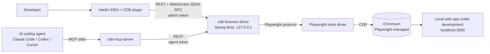
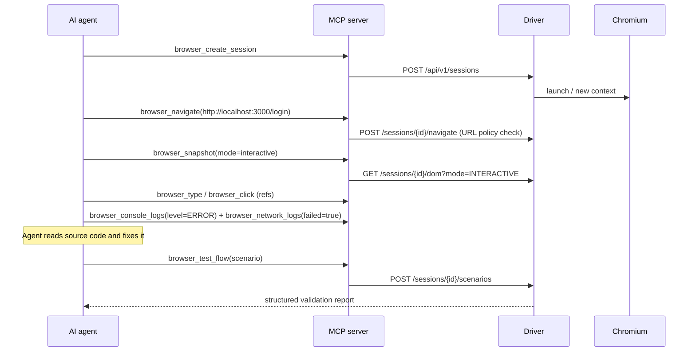

# System Design — Chromium Developer Bridge

## 1. Purpose

Chromium Developer Bridge (CDB) gives developers and AI coding agents a controlled, local, inspectable
Chromium browser. It captures runtime behaviour (DOM, console, network, screenshots) and exposes browser
actions through a documented local API, so that source code, runtime behaviour and AI-assisted development
form one feedback loop.

The **browser driver** is the product core. It runs on its own. The IntelliJ plugin and the MCP server are
clients of the driver API.

## 2. Context

## 3. Module layout (as built)

| Module | Kind | Responsibility |
|---|---|---|
| `shared-protocol` | Java library | Wire contract: DTOs, enums, event types, error codes. Jackson-annotated, no Spring. |
| `browser-core` | Java library | Provider SPI (`BrowserProvider`, `BrowserSessionDriver`), session manager, lifecycle state machine, URL/action security policy, redaction, bounded event buffers, event bus, source-map resolver, visual diff, scenario runner. No Spring, no Playwright. |
| `playwright-provider` | Java library | Default provider built on Playwright for Java: worker threads, Chromium launch, attach over CDP (localhost only), local browser discovery, DOM snapshot script, console/network capture. |
| `browser-api` | Java library | Typed Java client for the driver REST API plus the connection-file reader. Used by the MCP server and the integration tests. |
| `browser-driver` | Spring Boot app | REST controllers, WebSocket JSON-RPC event stream, authentication, origin/host validation, rate limiting, size limits, audit log, Actuator/Micrometer. |
| `mcp-server` | Java app (shaded jar) | MCP stdio server exposing 17 browser tools; thin client of the driver. |
| `intellij-plugin` | Kotlin, Gradle | Tool window (Browser, Elements, Console, Network, Screenshots, AI Agent, Sessions, Settings); driver lifecycle; source navigation. |
| `integration-tests` | Maven test module | Real-Chromium tests that start the driver and the sample app. |
| `sample-applications/login-demo` | Static web app + tiny server | Login, dashboard, form validation, failing API, JS error, responsive layout, a11y elements. |

### Deviations from the requested structure

The requested layout listed `chromium-provider`, `cdp-provider` and `playwright-provider` as separate modules.
They are merged into `playwright-provider` (packages `discovery`, `cdp`, `playwright`) because:

* Connecting to an existing Chromium (`connectOverCDP`) and launching Chromium both go through Playwright's
  `BrowserType`; a second hand-written CDP client would duplicate Playwright and be harder to keep correct.
* Local browser discovery is ~100 lines and only Playwright uses it.

The SPI in `browser-core` still allows a new provider module (for example a JCEF provider) to be added
without touching the driver. See [ADR-0003](../adr/0003-merge-provider-modules.md).

The OpenAPI document is hand-written first (`docs/api/OPENAPI.yaml`); a contract test makes sure that every
documented operation is served by a controller and vice versa, instead of generating server stubs. See
[ADR-0004](../adr/0004-contract-first-openapi-with-contract-test.md).

## 4. Technical feasibility assessment

### 4.1 Playwright for Java (default provider) — feasible, chosen

* Launches bundled Chromium (`playwright install chromium` happens on first run, or uses a configured
  executable or channel such as `chrome`/`msedge`).
* Gives contexts (cookie/storage isolation), pages (tabs), console, page errors, requests, responses,
  failures, WebSockets, screenshots, ARIA snapshots and raw CDP sessions (`context.newCDPSession`).
* **Threading:** Playwright Java is not thread-safe, and events are only delivered while the owning thread
  is inside a Playwright call. Every Playwright instance is owned by one `PlaywrightWorker` thread. All
  operations are queued to that thread; when idle, the worker "pumps" with `page.waitForTimeout(…)` so
  console and network events keep flowing. See [ADR-0002](../adr/0002-playwright-threading-model.md).

### 4.2 IntelliJ JCEF — feasible for preview, not for automation

* JCEF in IntelliJ (`JBCefBrowser`) is a separate Chromium runtime embedded in the IDE process. It does not
  share cookies, contexts or DOM with Playwright's Chromium.
* JCEF supports remote debugging only through the global registry key `ide.browser.jcef.debug.port`, which
  opens a CDP port for **all** JCEF browsers in the IDE (including IDE-internal ones). Exposing it would
  give agents control over IDE UI pages. Rejected for automation on security grounds.
* JCEF can't be guaranteed: some IDE runtimes ship without it (`JBCefApp.isSupported()` can be false).

**Decision:** the Playwright-managed Chromium is the one automated, inspected browser. The plugin shows
a **live preview** of that session (periodic viewport screenshots from the driver) plus an "open externally"
option for headed sessions; if JCEF is available it is only used to render the driver's own HTML views
(none in the MVP). The panel always shows which session is being inspected. See
[ADR-0001](../adr/0001-external-managed-chromium-as-primary-browser.md).

### 4.3 CDP directly — used through Playwright only

Attach to an existing Chromium through `connectOverCDP` is supported for `http://127.0.0.1|localhost|[::1]`
endpoints only. The driver never opens a public CDP port; Playwright launches Chromium over a pipe.

### 4.4 MCP — feasible, hand-rolled protocol layer

The MCP Java SDK changed packages and JSON bindings across 0.x → 1.x → 2.x (2.2.0 adds a `modern` package
and moves to Jackson 3). The stdio surface needed (initialize, tools/list, tools/call, ping, notifications)
is small, so the server implements MCP JSON-RPC directly with Jackson 2 and supports protocol
versions `2025-11-25`, `2025-06-18`, `2025-03-26`, `2024-11-05`. See [ADR-0005](../adr/0005-mcp-protocol-implementation.md).

### 4.5 Spring AI — not used

The driver does not call an LLM; agents bring their own model. Spring AI's MCP server starter would tie the
MCP server to Spring and the SDK version above. Spring AI may be useful later for an optional in-IDE
"AI Agent" tab that calls a model directly; documented as future work.

## 5. Key technical risks

| Risk | Impact | Mitigation |
|---|---|---|
| Playwright event delivery needs an active call | Missed console/network events | Worker pump loop (≤ 50 ms idle tick) |
| Chromium download on first launch (≈150 MB) | Slow first start, offline failure | `cdb.browser.executable-path` / `channel` config; discovery of local Chrome/Edge; clear error message |
| Page content steering an AI agent (prompt injection) | Agent does unintended actions | Untrusted-content envelopes, injection heuristics, URL allowlist, approval-gated sensitive actions, no JS eval over MCP |
| Local web pages calling the driver (CSRF / DNS rebinding) | Remote control of the browser | Bearer tokens, Origin rejection, Host header allowlist, 127.0.0.1 binding |
| Unbounded event growth | Memory exhaustion | Ring buffers with sequence numbers, per-connection bounded WebSocket queues, screenshot retention |
| IntelliJ platform API drift | Plugin build breaks | IntelliJ Platform Gradle Plugin 2.x, target 2025.2+ with `untilBuild` open, plugin verifier in CI |

## 6. Runtime view: AI-assisted fix loop

## 7. Cross-cutting concerns

* **Security:** see [SECURITY_DESIGN.md](../security/SECURITY_DESIGN.md) and [THREAT_MODEL.md](../security/THREAT_MODEL.md).
* **Sessions:** see [SESSION_LIFECYCLE.md](SESSION_LIFECYCLE.md).
* **Providers:** see [BROWSER_PROVIDERS.md](BROWSER_PROVIDERS.md).
* **Observability:** SLF4J + Logback with MDC (`correlationId`, `sessionId`), optional ECS structured logs
  (`logging.structured.format.console=ecs`), Actuator, Micrometer meters prefixed `cdb.`, optional
  Prometheus endpoint (`management.endpoints.web.exposure.include=prometheus`).
* **Storage:** everything lives under `~/.chromium-dev-bridge/` (connection file, audit logs, screenshots,
  baselines, profiles). No database.
